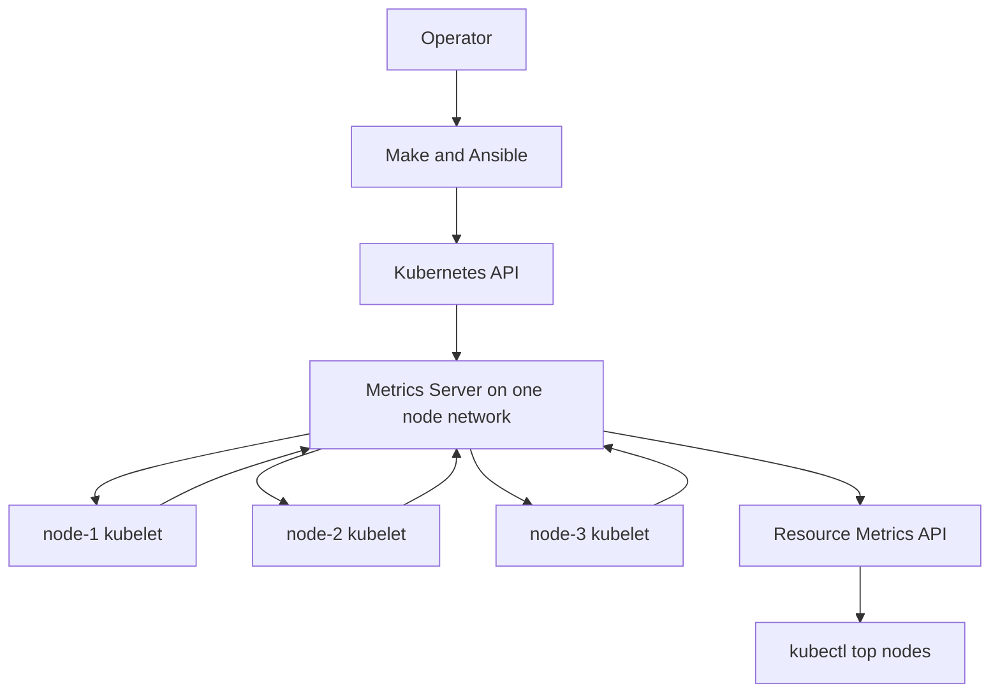

# feat: Add first-rung node resource metrics

## Overview

Add the smallest useful node-visibility layer to the existing kubeadm cluster:
a single, reproducibly managed Metrics Server instance and a one-command
operator path to view current CPU and memory use for every inventory node.

This is deliberately the first rung, not the finished observability stack.
Metrics Server keeps only short-lived in-memory data and powers the Kubernetes
Resource Metrics API and `kubectl top`; it does not provide Grafana dashboards,
history, disk or network metrics, alerting, or logs. Those remain a separate
Prometheus/Grafana phase after the repository has durable storage and GitOps.

## Problem Frame

The three physical nodes are now expected to run cluster services and future
agent workloads, but the operator cannot compare their live CPU and memory use
through the current repository workflow. The project roadmap ultimately calls
for `kube-prometheus-stack`, yet Argo CD, local-path storage, and the retention
policy that full monitoring depends on do not exist. Installing that whole stack
now would skip the repository's "climb the ladder" principle and introduce
storage, access, secrets, and alert-routing decisions before they are needed.

The useful first step is therefore current resource visibility through the
existing admin kubeconfig. It should be small enough to run without persistent
storage or ingress, but still follow this repository's standards for immutable
upstream inputs, idempotent Ansible reconciliation, explicit security tradeoffs,
and live post-deployment assertions.

## Requirements Trace

- **R1 — Start simple:** introduce one lightweight component, one replica, and
  no persistent volume, UI, ingress, credentials, or notification integration.
- **R2 — Cover every node:** the Resource Metrics API and `kubectl top nodes`
  must return CPU and memory for exactly the nodes in `cluster_hosts`, not merely
  succeed while silently omitting an unreachable node.
- **R3 — Be reproducible:** pin the Metrics Server release manifest and
  multi-architecture image by immutable SHA-256 values alongside the existing
  platform pins in `ansible/group_vars/all.yml`.
- **R4 — Reconcile safely:** a second unchanged run must be read-only, while
  missing or drifted managed resources must be repaired and then verified.
- **R5 — Expose no new user-facing service:** access stays behind the existing
  Kubernetes API and admin kubeconfig; no MetalLB address, Ingress, password, or
  plaintext secret is added.
- **R6 — Make limitations explicit:** operator documentation must distinguish
  live CPU/memory resource metrics from full node observability and preserve the
  later Prometheus/Grafana milestone.

## Scope Boundaries

- No Prometheus, Grafana, Alertmanager, node-exporter, kube-state-metrics, or
  Loki in this iteration.
- No historical retention, dashboards, alerts, log aggregation, disk-space,
  filesystem, SMART, temperature, or per-interface network metrics.
- No persistent storage, StorageClass dependency, ingress route, LAN address,
  ingress TLS certificate, or Grafana credential.
- No HPA/VPA policy is added; Metrics Server only establishes the data source
  those features could use later.
- No automatic approval of kubelet serving-certificate CSRs.
- No high-availability Metrics Server deployment; one replica matches the
  current single-control-plane learning stage.
- Do not hand-edit generated OpenWiki pages. Update source documentation and let
  the scheduled OpenWiki workflow regenerate its pages.

### Deferred to Separate Tasks

- **Strict Metrics Server transport:** add `serverTLSBootstrap`, a verified CSR
  approval/rotation procedure, strict kubelet certificate validation, and a
  stable Metrics Server serving certificate plus APIService CA bundle in a
  dedicated security task. These change certificate lifecycle and should not be
  hidden inside the first metrics deployment. Complete this hardening before
  introducing Agent Sandbox or other untrusted workload code.
- **Full monitoring:** deploy a storage-capped `kube-prometheus-stack` through
  Argo CD after local-path storage and GitOps exist; include node-exporter,
  dashboards, bounded retention, and a test alert there.
- **Logs:** add Loki only after the metrics stack is stable and its resource use
  is understood.

## Context & Research

### Relevant Code and Patterns

- `ansible/platform.yml` is the current pre-Argo entry point for cluster
  services and runs controller-side roles against the control-plane host.
- `ansible/roles/metallb/` is the closest pattern for a checksum-pinned upstream
  manifest whose deployed image is replaced with an immutable digest and whose
  live resources are asserted after reconciliation.
- `ansible/roles/traefik/` shows the local conventions for role argument specs,
  operator-owned pins, drift comparison, check-mode reporting, controller-side
  `kubectl`, targeted validation playbooks, and rollback documentation.
- `ansible/tests/traefik_validation.yml` and
  `ansible/tests/metallb_validation.yml` run controller-only decision tests as
  part of `make check`, without requiring a live cluster.
- `ansible/roles/hardening/tasks/main.yml` denies inbound host traffic by
  default but trusts traffic sourced from every inventory node. Running Metrics
  Server on the host network with a dedicated non-kubelet port reuses that
  existing node-to-node trust and avoids opening kubelet port 10250 to the whole
  Pod CIDR.
- `docs/PROJECT-PLAN.md`, `docs/homelab-roadmap.md`, and
  `docs/linux-k8s-foundations.md` already choose metrics before logs and reserve
  the complete Prometheus/Grafana stack for a later, storage-capped GitOps phase.

### Institutional Learnings

- No `docs/solutions/` knowledge base or critical-patterns file exists in this
  repository. Current role implementations, OpenWiki source maps, and recent
  platform commits are therefore the local patterns of record.
- Prior cluster work distinguishes static/offline validation from physical
  cluster proof. This plan retains a separate live deployment gate rather than
  treating Ansible syntax and decision tests as evidence that all three kubelets
  can actually be scraped.

### External References

- Metrics Server `v0.9.0` is the current upstream release as of 2026-08-05. Its
  release manifest SHA-256 is
  `1cec29a5267809306a2c6ec74a3e449abbb705b4a8beed0c8a1963910f72c79b`,
  and its multi-architecture image index digest is
  `d9862115e7c7881280d3d75ca26bda8ffc0fc213315979575bf23ce9826205c0`.
  The release targets Kubernetes 1.34+ and includes Kubernetes 1.36.2
  dependencies, matching this repository's Kubernetes 1.36 line.
- Upstream describes Metrics Server as an autoscaling/resource-metrics source,
  not a monitoring backend. It collects CPU and memory in memory at short
  intervals and exposes `metrics.k8s.io/v1beta1` for `kubectl top`.
- Upstream requires API aggregation, webhook-enabled kubelets, network access to
  each kubelet, and either CA-signed kubelet serving certificates or the
  explicitly insecure kubelet-TLS mode.
- Kubernetes documents that kubeadm uses self-signed kubelet serving
  certificates by default. Enabling signed certificates also creates an ongoing
  CSR approval requirement, including at rotation time; that lifecycle is why
  strict TLS is deferred rather than partially automated here.
- No deprecation or sunset notice was found for the Metrics Server project or
  Resource Metrics API. The API remains `v1beta1`, so availability and behavior
  must still be asserted rather than assumed from installation alone.

## Key Technical Decisions

| Decision | Choice for this iteration | Rationale |
|---|---|---|
| Visibility layer | Metrics Server only | Smallest component that gives immediate CPU/memory visibility and supports the roadmap's later scheduling work. |
| Deployment source | Official `v0.9.0` release manifest | Smaller supply-chain surface than adding a chart repository; mirrors the existing MetalLB manifest pattern. |
| Runtime placement | One worker-only, host-networked replica on a dedicated high port | Reuses existing node-to-node UFW trust without opening kubelet port 10250 to all pods; avoids the kubelet's own host port and keeps the extra network privilege off the control plane. |
| Node address | Prefer `InternalIP`, then hostname | Matches the repository's inventory-pinned kubelet addresses and avoids accidental external-address selection. |
| Kubelet TLS | Explicitly acknowledged, time-bounded insecure verification for this first rung | kubeadm's current serving certificates are self-signed; secure bootstrap and CSR rotation are materially larger lifecycle work. The tradeoff must be visible in operator config and docs and must be removed before untrusted sandbox workloads run. |
| Aggregated API TLS | Retain the upstream manifest's temporary `insecureSkipTLSVerify` behavior | Metrics Server generates an ephemeral serving certificate, so the APIService has no stable CA bundle in the simple manifest. Treat this as a second, independent TLS exception and remove it in the strict-transport follow-up. |
| User access | Existing admin kubeconfig and `kubectl top` | Adds no LAN-facing service, ingress, credentials, or authorization surface. |
| Ownership | Ansible before Argo CD | Matches `ansible/platform.yml`; a later GitOps task must adopt ownership before Ansible stops reconciling it. |

## Open Questions

### Resolved During Planning

- **Does the first version need Grafana?** No. The request prioritizes the
  simplest useful solution, and the repo lacks the storage and GitOps layers
  required to operate the planned full stack responsibly.
- **Should the role open TCP 10250 from `pod_cidr` on every node?** No. A
  host-networked Metrics Server on a dedicated port uses the already trusted
  node path and keeps the current host firewall contract unchanged.
- **Should TLS certificate lifecycle be bundled into this work?** No. The
  two insecure TLS hops are explicit homelab-only first-rung decisions; signed
  serving certificates, recurring CSR approval, and an APIService CA bundle
  belong to a separate hardening task.
- **Is Deployment readiness enough?** No. Completion requires an Available
  APIService and fresh node metrics for every inventory host.

### Deferred to Implementation

- **Exact managed annotation names and helper fact names:** follow the
  `homelab.home.arpa/*` and double-underscore conventions already used by the
  platform roles.
- **Whether state comparison needs a small included task file:** keep it in
  `tasks/main.yml` unless separating the pure comparison logic materially
  improves controller-only testability.
- **Exact retry count for first samples:** choose a bounded window long enough
  for the upstream 15-second collection interval while keeping failure feedback
  prompt.

## High-Level Technical Design

> *This illustrates the intended approach and is directional guidance for review, not implementation specification. The implementing agent should treat it as context, not code to reproduce.*

The role should verify the pinned upstream asset, transform only the deployment
fields required by this homelab (immutable image, host-network port, node-address
preference, resource bounds, and explicit kubelet-TLS mode), reconcile the
result, and then validate the complete API path rather than only the pod.

## Implementation Units

- [x] **Unit 1: Define the pinned Metrics Server contract**

**Goal:** Establish a small, explicit role interface and deterministic desired
manifest before any live-cluster mutation is implemented.

**Requirements:** R1, R3, R5, R6

**Dependencies:** None

**Files:**

- Create: `ansible/roles/metrics_server/defaults/main.yml`
- Create: `ansible/roles/metrics_server/vars/main.yml`
- Create: `ansible/roles/metrics_server/meta/argument_specs.yml`
- Create: `ansible/roles/metrics_server/meta/main.yml`
- Create: `ansible/roles/metrics_server/tasks/validate.yml`
- Create: `ansible/roles/metrics_server/tasks/prepare_manifest.yml`
- Create: `ansible/tests/metrics_server_validation.yml`
- Create: `ansible/tests/tasks/metrics_server_validation_case.yml`
- Modify: `ansible/group_vars/all.yml`

**Approach:**

- Add operator-owned values for the exact release, official manifest checksum,
  multi-architecture image digest, and an explicit acknowledgement that the
  first rung disables kubelet certificate verification.
- Keep namespace, resource names, host-network port, kubeconfig path, exact
  container arguments, resource requests/limits, expected object set, and
  immutable image reference inside role defaults/vars according to the existing
  platform-role boundary.
- Use the official single-replica manifest. Transform parsed YAML objects rather
  than relying on broad textual substitutions, and reject any unexpected
  upstream object shape before it can reach `kubectl`.
- Use a dedicated host-network port that cannot collide with the kubelet's
  10250 listener, with the matching secure-port argument, container port,
  `hostPort`, Service target, and host-network DNS policy treated as one
  invariant. Declaring `hostPort` lets the scheduler avoid a same-node bind
  collision during a rolling update.
- Select only nodes carrying the repository-managed worker label and add no
  control-plane toleration, keeping host networking away from the API/etcd host.
- Keep the upstream non-root, read-only filesystem, seccomp, probes, RBAC, and
  aggregation API resources unless a documented homelab constraint requires a
  change. Represent the APIService's upstream TLS skip explicitly in the desired
  contract rather than leaving it as an invisible manifest default.

**Patterns to follow:**

- Pin and validation placement in `ansible/group_vars/all.yml` and
  `ansible/roles/traefik/meta/argument_specs.yml`.
- Manifest constants and immutable image references in
  `ansible/roles/metallb/vars/main.yml`.
- Table-driven controller-only validation in
  `ansible/tests/traefik_validation.yml`.

**Test scenarios:**

- **Happy path:** valid `v0.9.0` version, 64-character manifest/image digests,
  explicit insecure-TLS acknowledgement, and three unique cluster hosts are
  accepted.
- **Happy path:** the desired manifest contract contains one replica, the exact
  image digest, host networking, host-network DNS, the dedicated secure port,
  matching host-port reservation, worker-only placement, `InternalIP` address
  preference, the 15-second metric resolution, the insecure kubelet-TLS flag
  exactly once, and the explicitly expected APIService TLS mode.
- **Edge case:** malformed versions, non-hex or wrong-length digests, an invalid
  port, duplicate/empty cluster host lists, and a missing security
  acknowledgement are rejected before cluster access.
- **Error path:** an upstream manifest whose expected Deployment, Service, or
  APIService shape has changed fails closed instead of producing a partial
  transformed manifest.

**Verification:**

- The role's public inputs are enforced by argument specs and validation.
- Controller-only tests can prove the desired security, networking, pinning,
  and resource contract without downloading assets or contacting a node.

- [x] **Unit 2: Reconcile and prove the complete node-metrics path**

**Goal:** Install or repair the pinned component idempotently and fail unless
all inventory nodes return fresh CPU and memory metrics.

**Requirements:** R2, R3, R4, R5

**Dependencies:** Unit 1

**Files:**

- Create: `ansible/roles/metrics_server/tasks/main.yml`
- Modify: `ansible/tests/metrics_server_validation.yml`
- Modify: `ansible/platform.yml`
- Modify: `Makefile`

**Approach:**

- Add the role to the pre-Argo platform play with both the common `platform`
  tag and a dedicated metrics tag so the full platform and the first-rung
  metrics path are independently runnable.
- Require the fetched kubeconfig and Ready inventory nodes before mutation.
- Inspect the well-known Metrics Server objects first. If a conflicting,
  unowned install exists, stop with an ownership error rather than silently
  adopting it.
- Download the versioned official release manifest, verify its checksum before
  parsing, and apply the narrow homelab transformations through the separately
  testable `prepare_manifest.yml` task.
- Compare the complete rendered object set with the live cluster using
  read-only `kubectl diff`; apply it only when the diff reports a change. This
  detects RBAC and other object drift without building a second custom state
  model. Check mode may download and diff the pinned asset, but must not apply
  it.
- After reconciliation, wait for the Deployment and APIService, assert the live
  image/network/security contract and worker placement, then poll the raw
  Resource Metrics API until its node-name set equals the inventory-derived
  cluster host set and every returned node includes CPU and memory usage.
- Add a small operator target that deploys only this tagged role and then shows
  the node metrics. Keep the existing baseline `status` target usable before
  Metrics Server is installed.

**Patterns to follow:**

- Kubeconfig, Ready-node, check-mode, and controller delegation patterns in
  `ansible/roles/traefik/tasks/main.yml`.
- Manifest verification, checksum markers, immutable live-image assertions, and
  drift repair in `ansible/roles/metallb/tasks/main.yml`.
- Complete live-object comparison via the existing controller-side `kubectl`
  pattern, keeping pure manifest preparation in the local validation playbook.

**Test scenarios:**

- **Happy path:** absent resources produce a diff and are applied; an exact
  managed object set produces an empty diff and a repeat execution reports no
  change.
- **Edge case:** a missing expected object, changed RBAC rule, tag-based image,
  wrong digest, altered host/host-network port, duplicate insecure-TLS flag, or
  changed APIService TLS setting produces a diff and is repaired.
- **Error path:** an existing Metrics Server workload without the repository's
  ownership marker is rejected with removal/adoption guidance.
- **Error path:** a checksum mismatch prevents the upstream manifest from being
  parsed or applied.
- **Integration:** a live three-node deployment reaches one Ready replica, an
  Available `v1beta1.metrics.k8s.io` APIService, and a Resource Metrics response
  containing `node-1`, `node-2`, and `node-3`, each with CPU and memory.
- **Integration:** blocking the scrape path or stopping one kubelet makes the
  role fail on the missing node metric rather than reporting partial success.
- **Integration:** an unchanged second live run performs only reads and returns
  zero Ansible changes.

**Verification:**

- The targeted operator workflow ends by displaying all three node rows.
- Static checks exercise input and state decisions; live deployment evidence is
  recorded separately and does not get conflated with local test success.

- [x] **Unit 3: Document operation, rollback, and the graduation boundary**

**Goal:** Make the first rung understandable and prevent it from being mistaken
for the roadmap's finished observability milestone.

**Requirements:** R1, R5, R6

**Dependencies:** Unit 2

**Files:**

- Create: `ansible/roles/metrics_server/README.md`
- Modify: `README.md`
- Modify: `docs/PROJECT-PLAN.md`
- Modify: `docs/homelab-roadmap.md`
- Modify: `docs/linux-k8s-foundations.md`

**Approach:**

- Document what `kubectl top` reports, expected sample delay, how the role uses
  the existing kubeconfig, and how to diagnose an unavailable APIService or a
  missing node row.
- State the host-network and insecure kubelet-TLS tradeoffs plainly, including
  the APIService's separate TLS skip, why both are bounded to this private
  first-rung deployment, and what the strict-transport follow-up must replace.
- Provide rollback based on the same checksum-verified, transformed managed
  object set so removal does not delete unrelated `kube-system` resources.
- Update roadmap source documents to show Metrics Server as the first rung while
  leaving the Grafana/live-dashboard/test-alert definition of done incomplete.
- Record the ownership handoff rule: when Argo CD later adopts Metrics Server,
  remove it from Ansible reconciliation in the same change so there is never a
  two-controller window.

**Patterns to follow:**

- Scope, traffic-path, idempotency, and rollback explanations in
  `ansible/roles/traefik/README.md`.
- Implemented-versus-roadmap language in `README.md` and
  `docs/PROJECT-PLAN.md`.

**Test scenarios:**

- Test expectation: none — this unit changes operator documentation only; the
  commands and outcomes it describes are verified by Unit 2's live gate.

**Verification:**

- A new operator can tell, without reading role internals, how to get current
  node CPU/memory, what is intentionally missing, how to troubleshoot a partial
  result, how to remove the component, and what work graduates the cluster to
  full monitoring.

## System-Wide Impact

- **Interaction graph:** the operator invokes Make/Ansible; controller-side
  `kubectl` reconciles an aggregated API service; the API server reaches the
  host-networked Metrics Server; Metrics Server reaches each kubelet; clients
  read the resulting metrics through the API server.
- **Error propagation:** missing kubeconfig, unready nodes, invalid pins,
  checksum mismatch, ownership collision, rollout failure, unavailable
  APIService, and incomplete node metrics must each fail the Ansible run with a
  message at that boundary.
- **State lifecycle risks:** applying a transformed upstream manifest can drift
  from later upstream shapes; validate expected objects before mutation and mark
  managed state with the exact source checksum. Compare the complete rendered
  set with `kubectl diff`, and do not silently adopt an independently installed
  Metrics Server.
- **Network/security impact:** no new LAN-facing Service or UFW rule is added,
  but the worker-only pod receives host networking, does not validate kubelet
  serving certificates, and is reached through an APIService that does not yet
  validate its ephemeral serving certificate. A node/LAN-path attacker could
  spoof metrics or intercept the projected Metrics Server token; its RBAC is
  limited but still exposes node/pod metadata and metrics. Restrict the role to
  its exact image, minimal upstream RBAC, port, security context, worker
  selector, and one replica, and treat strict transport on both hops as a gate
  before untrusted workloads.
- **API surface parity:** both the raw Resource Metrics API and the human
  `kubectl top nodes` workflow must work; Deployment readiness alone does not
  establish parity.
- **Integration coverage:** controller-only tests cannot prove API aggregation,
  host-network reachability, kubelet authentication, or complete three-node
  sampling. Those require the explicit live gate.
- **Unchanged invariants:** the existing Cilium, kube-proxy, MetalLB, Traefik,
  cluster endpoint, Pod CIDR, host firewall, admin kubeconfig, and control-plane
  taint contracts remain unchanged.

## Alternative Approaches Considered

- **Deploy `kube-prometheus-stack` now:** rejected for this iteration because it
  introduces storage, retention, dashboards, credentials, access, and alerts
  before local-path storage and Argo CD exist. It remains the planned complete
  monitoring solution.
- **Install Netdata or another host agent:** rejected because it creates a
  parallel observability path outside the chosen Kubernetes/Prometheus roadmap
  and still leaves Kubernetes Resource Metrics unavailable.
- **Allow `pod_cidr` to TCP 10250 on every node:** workable, but broader than
  needed for the first rung. Host networking lets the one trusted component use
  the repository's existing node-to-node firewall path.
- **Secure both TLS hops first:** strongest option, but it adds per-node kubelet
  configuration, initial and recurring CSR approval, stable Metrics Server
  serving certificates, and APIService CA-bundle management. That lifecycle
  deserves its own security-reviewed plan.
- **Run two Metrics Server replicas:** unnecessary while the cluster itself has
  one control plane; upstream also recommends API-server aggregator routing to
  realize the HA benefit.

## Success Metrics

- The targeted metrics workflow returns one fresh CPU/memory row for each of the
  three inventory nodes.
- The raw metrics node-name set exactly matches `cluster_hosts`.
- The Metrics Server pod runs on a labeled worker, never the control plane.
- A second unchanged run reports zero changes.
- No new LoadBalancer, Ingress, persistent volume, secret, or host firewall rule
  exists as a consequence of this iteration.
- Source documentation still shows Grafana plus a test alert as future work,
  preventing this first rung from prematurely closing Phase 3.5.

## Risks & Dependencies

| Risk or dependency | Mitigation |
|---|---|
| Both Metrics Server TLS hops initially skip certificate verification | Require an explicit operator acknowledgement, keep traffic on the trusted node path, document token-interception and metric-spoofing risk, and make signed kubelet certificates plus an APIService CA bundle prerequisites for untrusted sandbox workloads. |
| Host networking broadens the pod's network reach | Keep one worker-only non-root replica, immutable image, minimal upstream RBAC, read-only root filesystem, seccomp, explicit high port, and no control-plane toleration or user-facing Service exposure. |
| The chosen host port conflicts with another process | Validate the port, use a dedicated high port distinct from kubelet/API/etcd/ingress ports, and make live rollout failure explicit. |
| Metrics Server is mistaken for accurate historical monitoring | Repeat the boundary in the role README, root README, roadmap, and operator output; keep the Prometheus/Grafana milestone open. |
| One kubelet is unreachable but the component appears healthy | Compare raw node metrics against inventory and fail on any missing node. |
| Upstream release assets or manifests drift | Use the versioned release URL, manifest checksum, image index digest, expected-object validation, and live immutable-image assertion. |
| Current physical-cluster state is not proven by repository checks | Treat local validation and live rollout as separate gates; do not mark deployment complete without three-node evidence. |
| Later Argo CD adoption creates two reconcilers | Move ownership atomically: add the GitOps resource and remove the Ansible role from the platform play in the same migration. |

## Documentation / Operational Notes

- The first live run is a cluster-service rollout, not a host convergence or apt
  patch event; the host firewall stays unchanged under the host-network design.
- Allow at least one upstream collection interval before diagnosing an empty
  first response, but bound retries and surface logs/APIService conditions on
  timeout.
- Rollback removes the Metrics Server APIService and therefore intentionally
  makes `kubectl top` and future resource-metric consumers unavailable.
- Re-evaluate the release, manifest checksum, image digest, compatibility
  matrix, and security notes at implementation time if the plan is not executed
  promptly.

## Sources & References

- User request: plan simple node observability first (2026-08-05).
- Project direction: `docs/PROJECT-PLAN.md`, `docs/homelab-roadmap.md`, and
  `docs/linux-k8s-foundations.md`.
- Current platform patterns: `ansible/platform.yml`,
  `ansible/roles/metallb/`, and `ansible/roles/traefik/`.
- Metrics Server release:
  https://github.com/kubernetes-sigs/metrics-server/releases/tag/v0.9.0
- Metrics Server requirements and compatibility:
  https://github.com/kubernetes-sigs/metrics-server
- Kubernetes Resource Metrics pipeline:
  https://kubernetes.io/docs/tasks/debug/debug-cluster/resource-metrics-pipeline/
- kubeadm Metrics Server TLS limitation:
  https://kubernetes.io/docs/setup/production-environment/tools/kubeadm/troubleshooting-kubeadm/#cannot-use-the-metrics-server-securely-in-a-kubeadm-cluster
- Signed kubelet serving certificates:
  https://kubernetes.io/docs/tasks/administer-cluster/kubeadm/kubeadm-certs/#enabling-signed-kubelet-serving-certificates
