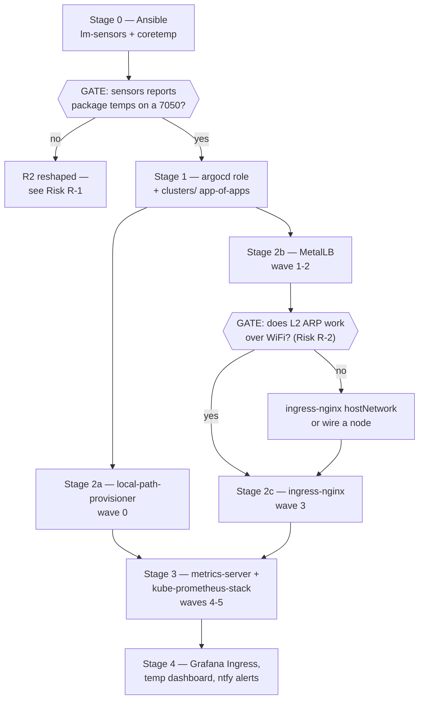

# ✨ feat: Node metrics dashboard and GitOps platform bootstrap

## Overview

Stand up per-node hardware visibility (CPU, RAM, disk, network, **temperatures**)
plus Kubernetes API request rate in Grafana, with four hardware alerts delivered
to the phone via ntfy.

The dashboard itself is a small amount of work. The bulk of this plan is the
prerequisite chain the brainstorm deliberately chose to build properly rather
than shortcut: Argo CD, a StorageClass, and LAN ingress
(see origin: `docs/brainstorms/2026-08-06-node-metrics-dashboard-requirements.md`,
"Key Decisions" → Argo CD bootstrap).

This closes **Phase 3.5** of `docs/PROJECT-PLAN.md` and, along the way, most of
Phase 2.5 and part of Phase 3.

## Problem Statement

Three used OptiPlex 7050s (i5-7500T, 16 GB, 256 GB NVMe) run the cluster with no
visibility into their health. `homelab-roadmap.md:181` already names the SSD as
"the real limit" — a disk quietly filling is the most likely way this homelab
breaks, and today the only way to notice is to SSH in and run `df -h`.

Thermals are the second unknown: these are small-form-factor machines with
T-series CPUs that will be asked to host agent sandboxes later. Nobody knows what
they run at under load.

## Proposed Solution

`kube-prometheus-stack`, in-cluster, delivered by Argo CD. Rejected alternatives
and their reasoning are carried forward in the origin document — briefly:

- **SigNoz rejected.** Its OTel `hostmetrics` receiver has no temperature
  scraper (R2 unmet), and ClickHouse wants 6–8 GB versus ~2.5 GB fleet-wide for
  kube-prometheus-stack. Revisit at Phase 4+ for application traces.
- **Prometheus never on node-1.** `roles/control_plane/tasks/main.yml` never
  removes kubeadm's `node-role.kubernetes.io/control-plane:NoSchedule` taint, and
  node-1 runs etcd. Prometheus TSDB compaction on the same NVMe as etcd's WAL is a
  known cause of fsync spikes, apiserver flakiness and spurious leader elections —
  a failure where the monitoring stack *causes* the instability it should reveal.
- **Argo CD bootstrapped imperatively, everything else GitOps.** Installing Phase
  2.5 by hand would leave four components outside git — the adoption debt the
  Argo-first choice existed to avoid.

## Technical Approach

### Where the boundary sits

`CLAUDE.md` draws a hard line: *Ansible owns the machines; Argo CD owns everything
inside the cluster.* This work crosses it, and the crossing is deliberate:

| Layer | Owns | Why |
|---|---|---|
| Ansible (`base` role) | `lm-sensors`, `coretemp` module | Hardware sensor enablement is a machine property |
| Ansible (`argocd` role) | Argo CD install only | Someone must install the installer |
| Ansible (`worker` role) | the `monitoring=true` node label | It already labels nodes; keeps placement declarative |
| Argo CD | everything else | local-path, MetalLB, ingress-nginx, metrics-server, kube-prometheus-stack |

There is **existing precedent** for Ansible applying in-cluster manifests:
`roles/control_plane` downloads, checksum-verifies, patches and applies the Calico
manifest (`roles/control_plane/tasks/main.yml`). The `argocd` role is a direct
copy of that pattern, so this is not a new architectural concession.

### Dependency graph



### Implementation Phases

---

#### Stage 0 — Ansible: hardware sensors *(the cheap gate)*

Runs first and alone because **R2 is the only requirement that can fail outright**,
and it costs almost nothing to test.

**Deviation from the brief, flagged:** the brief said `roles/kubernetes_node`. Put
it in **`roles/base`** instead. Temperature sensing is a machine property, not a
kubeadm prerequisite — these boxes should report temps even if Kubernetes is never
installed. `kubernetes_node`'s existing `modules-load.d` block is the *pattern* to
copy, not the place to put it.

**Files:**

- `ansible/roles/base/defaults/main.yml` — add `lm-sensors` to `base_packages`
- `ansible/roles/base/tasks/main.yml` — new block, mirroring
  `roles/kubernetes_node/tasks/main.yml`:

```yaml
# ansible/roles/base/tasks/main.yml
# --- hardware sensors ------------------------------------------------------
# coretemp exposes per-core and package temperatures through /sys/class/hwmon,
# which is where node_exporter's hwmon collector reads from. On most kernels it
# autoloads from the CPU modalias, but "most" is not "always" and a missing
# sensor is silent — the metric simply never appears.
- name: Load hardware sensor modules at boot
  ansible.builtin.copy:
    dest: /etc/modules-load.d/sensors.conf
    owner: root
    group: root
    mode: "0644"
    backup: true
    content: |
      {{ __base_managed_header }}
      coretemp

- name: Load sensor modules now
  community.general.modprobe:
    name: "{{ item }}"
    state: present
  loop: "{{ base_sensor_modules }}"
```

- `ansible/roles/base/meta/argument_specs.yml` — add `base_sensor_modules`
- `ansible/roles/base/README.md` — document, including **rollback**
  (`rm /etc/modules-load.d/sensors.conf`, `modprobe -r coretemp`)

**⛔ VERIFICATION GATE — do not proceed until this passes:**

```bash
# on node-3
sensors                                    # expect coretemp-isa-0000, Package id 0
ls /sys/class/hwmon/                       # expect at least hwmon0
grep . /sys/class/hwmon/hwmon*/name        # expect "coretemp"
cat /sys/class/hwmon/hwmon*/temp1_input    # millidegrees, e.g. 42000
```

`node_exporter` reads sysfs directly — `lm-sensors` is for *human* verification
only, not a runtime dependency. If `/sys/class/hwmon` is populated, R2 is
achievable even if the `sensors` command is absent.

**If this fails:** see Risk R-1. Do not start Stage 1 assuming R2 will land.

**Optional:** `dell-smm-hwmon` (possibly with `force=1`) exposes Dell-specific
sensors including fan speed. Try it only if `coretemp` alone is insufficient — it
is known to be unreliable on some Dell desktop models.

---

#### Stage 1 — Argo CD bootstrap + `clusters/` tree

**New role `ansible/roles/argocd/`**, modelled directly on the Calico block in
`roles/control_plane/tasks/main.yml`. Runs on the control-plane host with
`KUBECONFIG=/etc/kubernetes/admin.conf`.

**`ansible/group_vars/all.yml`** — new pinned versions with digests, following the
existing comment style:

```yaml
# --- GitOps ----------------------------------------------------------------
# sha256 of https://raw.githubusercontent.com/argoproj/argo-cd/<ver>/manifests/install.yaml
# Git tags are mutable, so this digest is what makes the bootstrap reproducible.
argocd_version: "vX.Y.Z"          # RESOLVE AT IMPLEMENTATION TIME
argocd_manifest_sha256: "..."     # curl -fsSL <url> | sha256sum

# The git repo Argo CD syncs from.
argocd_repo_url: "https://github.com/bornakapusta/homelab.git"
argocd_repo_revision: "master"
```

> **Do not copy a version number from this plan.** Resolve every version at
> implementation time and generate its digest with `curl -fsSL <url> | sha256sum`,
> per the convention in `CLAUDE.md` and the header comment in `group_vars/all.yml`.

**Role tasks** (`ansible/roles/argocd/tasks/main.yml`), following repo conventions
(`__argocd_` prefixed internals, `backup: true`, provenance header from
`vars/main.yml`):

1. `stat`/`kubectl get deploy -n argocd argocd-server` → skip if present
2. `get_url` manifest → `/root/argocd-install.yaml`, `mode: "0600"`,
   `checksum: "sha256:{{ argocd_manifest_sha256 }}"`
3. create the `argocd` namespace
4. `kubectl apply -n argocd -f /root/argocd-install.yaml`
5. `kubectl -n argocd rollout status deploy/argocd-server --timeout=300s`
6. remove `/root/argocd-install.yaml`
7. apply the root Application (app-of-apps)
8. retrieve the initial admin password, `no_log: true`, and print *where to find
   it* rather than the value

**`clusters/` tree** — layout is already specified in `docs/PROJECT-PLAN.md:176-177`
and `README.md:11`; follow it exactly rather than inventing one:

```
clusters/
├── bootstrap/
│   └── root-app.yaml              # app-of-apps, points at clusters/platform/
└── platform/
    ├── local-path-provisioner.yaml   # sync-wave 0
    ├── metallb.yaml                  # sync-wave 1
    ├── metallb-config.yaml           # sync-wave 2 (CRs — needs CRDs from wave 1)
    ├── ingress-nginx.yaml            # sync-wave 3
    ├── metrics-server.yaml           # sync-wave 4
    └── kube-prometheus-stack.yaml    # sync-wave 5
```

**Verification gate:**
```bash
kubectl -n argocd get pods            # all Running
kubectl -n argocd get applications    # root app Synced/Healthy
kubectl port-forward -n argocd svc/argocd-server 8080:443   # UI loads
```

**Repo access check:** confirm whether `github.com/bornakapusta/homelab` is public.
If private, Argo CD needs a repository credential Secret before the root app can
sync — a prerequisite that would otherwise surface as a confusing `ComparisonError`.

---

#### Stage 2 — Platform components (Argo-managed)

**2a. local-path-provisioner** *(sync-wave 0)*

- Annotate its StorageClass `storageclass.kubernetes.io/is-default-class: "true"`
- **Set the data path deliberately.** The chart defaults to
  `/opt/local-path-provisioner`, which lands on the root LV. Phase 1 gave these
  machines a **separate `/var` LVM volume** (`docs/PROJECT-PLAN.md:96`), so point it
  at `/var/lib/local-path-provisioner` instead — *after* confirming `/var` has the
  headroom. Note `/var/lib/containerd` shares that volume, so Prometheus TSDB and
  container images compete for it.

```bash
# on node-3, BEFORE choosing retentionSize
df -h /var /
lsblk
```

**2b. MetalLB** *(sync-waves 1 and 2)*

Split into two Applications: the chart (wave 1) and the `IPAddressPool` /
`L2Advertisement` CRs (wave 2). A single Application fails on first sync because
the CRs are validated before the CRDs exist.

Pool must sit **outside the Fritz!Box DHCP range** — nodes are
`192.168.178.26-28` (`ansible/inventory.ini`), so something like
`192.168.178.240-192.168.178.250`, verified against the router's DHCP settings
first.

**⛔ VERIFICATION GATE — test MetalLB before anything depends on it (Risk R-2):**

```bash
kubectl create deploy lbtest --image=nginx
kubectl expose deploy lbtest --port=80 --type=LoadBalancer
kubectl get svc lbtest                      # EXTERNAL-IP assigned?
curl http://<external-ip>                   # reachable from the laptop?
arping -I <laptop-iface> <external-ip>      # still reachable after 5 minutes?
kubectl delete deploy,svc lbtest
```

The five-minute recheck matters: the documented WiFi failure mode is that the
service *works initially and breaks shortly afterwards*.

**2c. ingress-nginx** *(sync-wave 3)*

Standard install, `Service.type=LoadBalancer` consuming a MetalLB IP — or
`hostNetwork: true` if gate 2b failed.

---

#### Stage 3 — metrics-server + kube-prometheus-stack

**metrics-server** *(sync-wave 4)* — satisfies R4.

The classic kubeadm gotcha: kubelet serving certs are self-signed, so
metrics-server fails TLS verification and `kubectl top` returns
`error: Metrics API not available`.

```yaml
args:
  - --kubelet-insecure-tls
  - --kubelet-preferred-address-types=InternalIP,Hostname,ExternalIP
```

The *correct* fix is `serverTLSBootstrap: true` in the KubeletConfiguration plus a
CSR approver. Use `--kubelet-insecure-tls` now and record the follow-up — but note
it in `roles/kubernetes_node/README.md` so it is not forgotten, since it slightly
undercuts the repo's hardening posture.

**kube-prometheus-stack** *(sync-wave 5)*

Two Argo CD gotchas that will bite on first sync if not pre-empted:

1. **CRD annotation size.** The Prometheus Operator CRDs exceed Kubernetes'
   262144-byte annotation limit, and Argo CD's client-side apply stores
   `last-applied-configuration`. Set `ServerSideApply=true` in the Application's
   `syncOptions`.
2. **CRD ownership.** Use `skipCrds: false` with server-side apply, or manage CRDs
   as a separate Application — do not let two Applications both claim them.

Values file, encoding the decisions from the origin document:

```yaml
# clusters/platform/kube-prometheus-stack.yaml (helm.valuesObject)

# --- placement: node-3, never node-1 (etcd fsync contention) ---
prometheus:
  prometheusSpec:
    nodeSelector: { homelab.local/monitoring: "true" }
    retention: 15d
    retentionSize: 15GB          # must be < PVC size; see sizing note
    resources:
      requests: { cpu: 200m, memory: 1Gi }
      limits:   { memory: 2Gi }   # no CPU limit — throttling Prometheus causes scrape gaps
    storageSpec:
      volumeClaimTemplate:
        spec:
          storageClassName: local-path
          resources: { requests: { storage: 20Gi } }

grafana:
  nodeSelector: { homelab.local/monitoring: "true" }
  persistence: { enabled: false }        # stateless — dashboards come from git
  admin: { existingSecret: grafana-admin }
  sidecar:
    dashboards: { enabled: true, label: grafana_dashboard }

alertmanager:
  alertmanagerSpec:
    nodeSelector: { homelab.local/monitoring: "true" }
    storage:
      volumeClaimTemplate:
        spec:
          storageClassName: local-path
          resources: { requests: { storage: 2Gi } }
```

**`retentionSize` must be meaningfully below the PVC size** — Prometheus needs
headroom for compaction, and the limit is enforced lazily. 15 GB in a 20 Gi volume
is a sane starting ratio; confirm against actual `/var` free space from Stage 2a.

**Node label** — extend `roles/worker/tasks/main.yml`, which already reads and
applies `node-role.kubernetes.io/worker` with the read-then-label idempotency
pattern. Copy it for `homelab.local/monitoring=true`, driven by a new
`group_vars/all.yml` variable:

```yaml
# Which worker carries the monitoring stack. Effectively PERMANENT: with
# local-path-provisioner the PV is a directory on this node and the PVC acquires
# node affinity, so moving it later means losing the metric history.
# Must NOT be the node that later carries the agent-sandbox taint.
monitoring_node: node-3
```

**Silencing the HA-assuming rules (R7).** On kubeadm, `kube-controller-manager`,
`kube-scheduler` and `kube-proxy` bind to `127.0.0.1`, so Prometheus cannot scrape
them and `KubeControllerManagerDown` / `KubeSchedulerDown` / `KubeProxyDown` fire
permanently. Two options:

| Option | Effect | Verdict |
|---|---|---|
| **A. Patch bind addresses** — `--bind-address=0.0.0.0` on the controller-manager and scheduler static pods + `metricsBindAddress` on kube-proxy | You actually *get* control-plane metrics | **Recommended.** Exposes 10257/10249/10259 on the LAN, which ufw already restricts to peers. Genuinely useful signals, and reinforces R3. |
| B. Disable scrape targets + rules — `kubeControllerManager.enabled: false`, `kubeScheduler.enabled: false`, `defaultRules.disabled` | Quiet, but blind | Fallback. Note that [helm-charts#3324](https://github.com/prometheus-community/helm-charts/issues/3324) reports `defaultRules.disabled` not reliably suppressing these three — which itself argues for A. |

Also expect noise from `KubeCPUOvercommit` / `KubeMemoryOvercommit` (they assume a
node's loss can be absorbed — false on 3 nodes) and `InfoInhibitor`. `Watchdog`
fires permanently **by design** as a deadman switch: route it to a `null` receiver,
or repurpose it as a low-priority ntfy heartbeat.

---

#### Stage 4 — Make it useful

**Grafana Ingress** *(R5)* — plain HTTP, no TLS, no cert-manager
(see origin: Scope Boundaries). Host `grafana.lab.example`, matching the existing
`k8s.lab.example` convention from `control_plane_endpoint`. Laptop needs an
`/etc/hosts` entry — extend `make hosts` to emit that line too.

**Grafana admin secret** — no secret management exists yet (SOPS/Sealed Secrets is
Phase 3, incomplete). Do **not** put `adminPassword` in git. Use the mechanism the
repo already has: an `ansible-vault` file, following the existing
`ansible/vars/tailscale.vault` pattern, with an Ansible task creating the
`grafana-admin` Secret. Same mechanism for the ntfy topic, which is itself a
capability token — anyone who knows the topic name can read the alerts.

**Temperature dashboard** *(R2)* — kube-prometheus-stack ships no temperature
panel. Add a dashboard as a ConfigMap labelled `grafana_dashboard: "1"`, picked up
by the sidecar and therefore stored in git.

```promql
# per-node temperature, human-readable sensor names
node_hwmon_temp_celsius
  * on(instance, chip, sensor) group_left(label)
  node_hwmon_sensor_label

# headroom against the chip's own critical threshold — preferred over a
# hardcoded number, since it adapts if the sensor set changes
node_hwmon_temp_celsius / node_hwmon_temp_crit_celsius
```

Validate the actual label set on a real node before finalising the panel —
`chip="platform_coretemp_0"`, `sensor="temp1"` are the expected values but should
be confirmed, not assumed.

**ntfy alerting** *(R6)* — ⚠️ **Alertmanager cannot template its webhook body.**
`webhook_configs` posts a fixed JSON schema, so pointing it straight at
`https://ntfy.sh/<topic>` delivers an unreadable JSON blob to the phone. A bridge
is required. Use [`ntfy-alertmanager`](https://codeberg.org/xenrox/ntfy-alertmanager)
(priority mapping, tags, silence action buttons) or
[`alertmanager-ntfy`](https://github.com/alexbakker/alertmanager-ntfy), deployed as
a small Deployment in the `monitoring` namespace.

**Four hardware alerts** as a `PrometheusRule` in git:

```yaml
- alert: NodeDiskFillingUp        # the failure this project is most likely to hit
  expr: |
    100 - (node_filesystem_avail_bytes{fstype!~"tmpfs|squashfs|fuse.lxcfs"}
           / node_filesystem_size_bytes * 100) > 80
  for: 15m

- alert: NodeDown
  expr: up{job="node-exporter"} == 0
  for: 5m

- alert: NodeHighTemperature
  expr: node_hwmon_temp_celsius / node_hwmon_temp_crit_celsius > 0.9
  for: 5m

- alert: NodeMemoryPressure
  expr: |
    node_memory_MemAvailable_bytes / node_memory_MemTotal_bytes * 100 < 10
  for: 15m
```

**⛔ FINAL VERIFICATION GATE:**

Test by **temporarily lowering a threshold** to below current usage, confirming the
phone buzzes, then reverting. Prefer this over `fallocate` — deliberately filling a
256 GB NVMe on a node hosting the Prometheus PVC risks corrupting the TSDB you just
built. If you do use `fallocate`, size it precisely and script the cleanup.

Then let it run 48 hours and confirm the channel is silent (R7).

---

## Alternatives Considered

Carried forward from the origin document — see it for full reasoning.

| Alternative | Why rejected |
|---|---|
| SigNoz | No temperature scraper in OTel `hostmetrics`; 6–8 GB for ClickHouse vs ~2.5 GB; no applications to trace yet |
| Prometheus on node-1 | Requires untainting the control plane; etcd fsync contention |
| Helm now, adopt into Argo CD later | User chose no-throwaway; adoption is fiddly and leaves a window where cluster state is not in git |
| NodePort over Tailscale for access | Rejected in favour of proper ingress — **but see Risk R-2**, this may return as the fallback |
| Grafana with persistence | Stateless + git-sourced dashboards avoids a second node-pinned PVC and keeps dashboards reviewable |

## System-Wide Impact

**Interaction graph.** `site.yml` runs `serial: 1` + `any_errors_fatal` — Stage 0's
`base` change is a patch event on each node in turn. `base` also runs `apt upgrade`,
so adding `lm-sensors` coincides with a possible kernel bump. Note the ordering
hazard documented in `CLAUDE.md`: `meta: flush_handlers` in `kubernetes_node` is
**play-global** and is what actually fires `hardening`'s `Reload sshd`. Adding
handlers to `base` interacts with that — prefer plain tasks over new handlers in
Stage 0.

**Error propagation.** Argo CD auto-sync will retry failures indefinitely. A wrong
sync-wave manifests as a permanently `Progressing` Application, not a hard error —
watch `kubectl -n argocd get applications` rather than assuming success.

**State lifecycle.** The Prometheus PVC binding to node-3 is the one genuinely
irreversible step in this plan. Once bound, moving Prometheus means losing history.
**Confirm `monitoring_node` before Stage 3 syncs.**

**Resource footprint.** ~2.5 GB across 48 GB fleet, concentrated on node-3 (~2 GB).
node-3 has ~2 GB less headroom for future workloads.

**Integration scenarios unit tests will not catch:** (1) node-3 reboots — does
Prometheus reschedule and reattach its local-path PV? (2) Alertmanager restarts —
are silences preserved? (3) MetalLB speaker failover across WiFi. (4) A `make nodes`
run that reboots a node while Prometheus is mid-compaction.

**Molecule.** `make test` covers only `hardening`. Stage 0 touches `base`, which has
no scenario, and the rest is out-of-container by nature. **No automated test
coverage is added by this work** — the verification gates above are the tests.

## Acceptance Criteria

### Functional

- [ ] **R1** — CPU, memory, disk usage/IO and network bandwidth visible for all 3 nodes
- [ ] **R2** — per-node temperatures graphed over time, with history
- [ ] **R3** — kube-apiserver request rate visible
- [ ] **R4** — `kubectl top nodes` and `kubectl top pods` return data
- [ ] **R5** — Grafana reachable from the laptop at a stable address, no port-forward
- [ ] **R6** — disk / node-down / temperature / memory alerts reach the phone via ntfy
- [ ] **R7** — after 48 h of normal operation, zero permanently-firing alerts
- [ ] **R8** — retention capped in time *and* size; worst-case footprint fits `/var`
- [ ] **R9** — every component has resource requests and limits
- [ ] **R10** — everything except the Argo CD bootstrap is defined in git

### Quality gates

- [x] `make check` passes — ansible-lint `production` profile, **`skip_list` still empty**
- [ ] `make test` still passes (hardening scenario unaffected)
- [ ] New `argocd` role has `README.md` (purpose, arguments, idempotency, **rollback**) and `meta/argument_specs.yml`
- [x] `base` argument spec updated for `base_sensor_modules`
- [ ] Internal vars `__<role>_` prefixed; role defaults `<role>_` prefixed
- [ ] Every written file carries its role's `__<role>_managed_header` and `backup: true`
- [ ] No role references `groups[...]` — resolve through `group_vars/all.yml`
- [ ] All new versions pinned **with sha256 digests** in `group_vars/all.yml`
- [ ] `ansible-playbook site.yml && ansible-playbook site.yml` — second run reports zero changes
- [ ] No secret in git; Grafana admin password and ntfy topic via ansible-vault
- [ ] `docs/PROJECT-PLAN.md` Phase 2.5 / 3 / 3.5 checkboxes updated

## Risks & Mitigation

**R-2 is the one most likely to derail this plan.**

| # | Risk | Likelihood | Mitigation |
|---|---|---|---|
| **R-1** | `coretemp` yields no usable sensors on the 7050 → **R2 unachievable** | Low | Stage 0 gate tests it first and cheaply. Fallbacks: `dell-smm-hwmon`, or IPMI/`smartctl` NVMe temps (`node_nvme_*`) as a partial substitute. If all fail, R2 is dropped and the origin doc amended. |
| **R-2** | **MetalLB L2 does not work over WiFi.** Documented: WiFi APs commonly run ARP proxy or client isolation; the service works initially then breaks. These nodes are on WiFi (`base` role disables WiFi power-save; roadmap says "wired later") | **Medium-High** | Gate 2b tests with a throwaway LoadBalancer *before* anything depends on it, including a 5-minute recheck. Fallbacks, in order: (1) wire one node and pin the L2 speaker to it via node selector — only one wired node is needed; (2) `ingress-nginx` with `hostNetwork: true`, skipping MetalLB; (3) NodePort over Tailscale, the option the brainstorm rejected. **All three still satisfy R5.** |
| R-3 | Prometheus PVC binds to the wrong node — effectively irreversible | Low | Confirm `monitoring_node` before Stage 3 syncs; label before the Application is created |
| R-4 | kube-prometheus-stack CRDs exceed the 262144-byte annotation limit | High if unhandled | `ServerSideApply=true` from the first sync |
| R-5 | Prometheus fills `/var`, taking containerd's image store with it | Medium | `retentionSize` well below PVC size; measure `df -h /var` first; `NodeDiskFillingUp` alert covers the general case |
| R-6 | Alert fatigue from HA-assuming defaults → R6 becomes worthless | High if unhandled | Stage 3 Option A + `Watchdog` to a null receiver; R7's 48-hour silence is the acceptance test |
| R-7 | Scope creep — this plan quietly delivers Phases 2.5 and 3 | Certain | Accepted deliberately (see origin: Dependencies). Update the checkboxes so the roadmap reflects reality. |

## Deferred Questions — Resolved

From the origin document's "Deferred to Planning":

| Question | Resolution |
|---|---|
| Does `hwmon` work on the 7050? | **Gated, not assumed** — Stage 0 verification gate. `coretemp` is the expected chip; the collector is on by default and reads sysfs, so `lm-sensors` is not a runtime dependency |
| Which temperature dashboard? | **Custom ConfigMap dashboard**, PromQL supplied in Stage 4. No bundled panel exists |
| Which bundled rules to disable? | **Prefer patching bind addresses over disabling** (Stage 3, Option A). Known offenders: `KubeControllerManagerDown`, `KubeSchedulerDown`, `KubeProxyDown`, `KubeCPUOvercommit`, `KubeMemoryOvercommit`, `InfoInhibitor`, `Watchdog` |
| Hosted vs self-hosted ntfy? | **Hosted `ntfy.sh`.** Self-hosting creates a circular dependency — the alert path would depend on the cluster it alerts about. Treat the topic name as a secret |
| Retention values? | **15d / 15GB in a 20Gi PVC**, contingent on `df -h /var` from Stage 2a |
| Where do Argo manifests live? | **`clusters/bootstrap/` + `clusters/platform/`**, exactly as specified in `docs/PROJECT-PLAN.md:176-177` |

## Open Questions

1. ~~**Is `github.com/bornakapusta/homelab` public or private?**~~ **RESOLVED
   2026-08-07: public.** Argo CD needs no repository credential Secret. One
   prerequisite removed from Stage 1.
2. **Is node-3 the right permanent home?** Effectively irreversible once the PVC
   binds. Constraint: must not be the future agent-sandbox node.
3. **Will any node be wired before Stage 2?** Materially de-risks R-2 — one wired
   node is enough.

## Sources & References

### Origin

- **Origin document:** [`docs/brainstorms/2026-08-06-node-metrics-dashboard-requirements.md`](../brainstorms/2026-08-06-node-metrics-dashboard-requirements.md)
  — decisions carried forward: kube-prometheus-stack over SigNoz; Prometheus pinned
  to a non-control-plane worker; Argo CD bootstrapped imperatively with all else GitOps;
  TLS deferred; alerts to ntfy.

### Internal

- `ansible/roles/control_plane/tasks/main.yml` — the Calico download/verify/apply block the `argocd` role copies
- `ansible/roles/worker/tasks/main.yml` — read-then-label idempotency pattern for the monitoring label
- `ansible/roles/kubernetes_node/tasks/main.yml` — `modules-load.d` + `modprobe` pattern for Stage 0
- `ansible/roles/kubernetes_node/vars/main.yml` — why `ansible_managed` is unusable in `copy: content:`
- `ansible/group_vars/all.yml` — version + digest pinning convention
- `ansible/inventory.ini` — node IPs; MetalLB pool must avoid the Fritz!Box DHCP range
- `docs/PROJECT-PLAN.md:176-177` — the `clusters/` layout
- `CLAUDE.md` — Ansible/Argo boundary, lint policy, naming rules, `flush_handlers` hazard

### External

- [MetalLB layer 2 concepts](https://metallb.universe.tf/concepts/layer2/) and [troubleshooting](https://metallb.universe.tf/troubleshooting/) — L2/ARP limitations
- [Fixing MetalLB WiFi ARP issues](https://oneuptime.com/blog/post/2026-02-20-metallb-wifi-arp-raspberry-pi/view) — the WiFi failure mode behind R-2
- [helm-charts#3324](https://github.com/prometheus-community/helm-charts/issues/3324) — `defaultRules.disabled` not reliably suppressing the kubeadm control-plane alerts
- [prometheus-operator#1859](https://github.com/prometheus-operator/prometheus-operator/issues/1859) — kubeadm `bind-address` root cause
- [node_exporter hwmon collector](https://github.com/prometheus/node_exporter/blob/master/collector/hwmon_linux.go) and [Robust Perception on temperature metrics](https://www.robustperception.io/temperature-and-hardware-monitoring-metrics-from-the-node-exporter/)
- [node_exporter#2986](https://github.com/prometheus/node_exporter/issues/2986) — sensors present but metrics missing; the case Stage 0's gate exists to catch
- [`ntfy-alertmanager`](https://codeberg.org/xenrox/ntfy-alertmanager) · [`alertmanager-ntfy`](https://github.com/alexbakker/alertmanager-ntfy) · [ntfy integrations](https://docs.ntfy.sh/integrations/)
