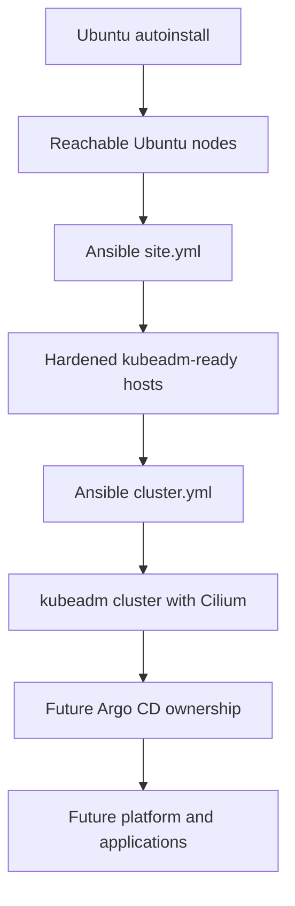

# Architecture overview

## Responsibility layers

The design deliberately separates installation, machine convergence, cluster bootstrap, and future workload reconciliation.

This flow shows the ownership handoff from OS installation through host automation to the planned GitOps layer.

- `autoinstall/` is a starting point for reproducible OS installation.
- `ansible/site.yml` owns repeatable host state.
- `ansible/cluster.yml` owns kubeadm initialization, initial Cilium installation, and worker joins.
- Future `clusters/` content will let Argo CD own in-cluster platform and application resources.

The executable details live in the [provisioning workflows](/openwiki/workflows/provisioning.md), while the [source map](/openwiki/source-map.md) separates current files from roadmap-only directories.

## Current topology

Stage A is intentionally one control plane and two workers:

| Node | Address | Role |
|---|---:|---|
| `node-1` | `192.168.178.11` | kubeadm control plane and stacked etcd |
| `node-2` | `192.168.178.44` | worker |
| `node-3` | `192.168.178.66` | worker |

`k8s_cluster` is the inventory union of both role groups. Preflight enforces exactly one control-plane node. The future HA shape is three control-plane nodes behind kube-vip; exactly two is forbidden because losing either destroys etcd quorum.

The control-plane endpoint is a DNS name rather than a node IP. This gives certificates a stable identity that can later point at kube-vip, but the endpoint and current advertise address are still immutable bootstrap choices. Their cross-cutting uses are described in [configuration and security](/openwiki/domain/configuration-and-security.md).

## Node convergence composition

`ansible/site.yml` runs one host at a time with `serial: 1` and stops on the first error:

1. `preflight` validates controller version, inventory shape, identities, endpoint, versions, digests, and network assumptions.
2. `base` sets hostname, endpoint resolution, time, packages, Wi-Fi stability, optional Tailscale, and reboot reporting.
3. `automation_user` creates the dedicated key-only root-capable automation identity.
4. `hardening` locks down SSH, configures UFW, and enables security upgrades without automatic reboot.
5. `kubernetes_node` disables swap, configures kernel networking and containerd, and installs pinned kubeadm packages.

The ordering is semantic, not merely navigational. `automation_user` must precede `hardening` so `AllowUsers` cannot exclude an account before it exists. `kubernetes_node` calls play-global `flush_handlers`, which currently fires pending hardening handlers; role reordering therefore requires special review.

This architecture depends on the invariants documented in [configuration and security](/openwiki/domain/configuration-and-security.md) and is guarded by the checks in [testing and validation](/openwiki/testing.md).

## Cluster bootstrap composition

`ansible/cluster.yml` has three plays:

1. Run `preflight` and `control_plane` on `node-1`.
2. Run `worker` on `node-2` and `node-3`.
3. Return to `node-1`, wait for Cilium on all joined nodes, and report cluster state.

The control-plane role uses `/etc/kubernetes/admin.conf` as its initialized-state sentinel. It creates and fetches an admin kubeconfig, then drives Helm from the controller directly against the API node IP so initial laptop DNS is not a bootstrap dependency.

The minimal Cilium profile intentionally keeps kube-proxy, uses Kubernetes PodCIDR IPAM and VXLAN, enables standard NetworkPolicy, and disables Hubble, Envoy, and L7 proxying. This keeps initial scope narrow; richer Cilium features belong to future GitOps ownership.

Workers use `/etc/kubernetes/kubelet.conf` as local join state and compare it with API membership. A stale local file without a matching Node causes a hard failure rather than a false successful run. See the [provisioning workflows](/openwiki/workflows/provisioning.md) for the sequence and recovery path.

## External integration points

| Integration | Role in the system |
|---|---|
| SSH and sudo | Controller access and privilege escalation to nodes |
| Docker and Kubernetes apt repositories | Pinned containerd and kubelet/kubeadm/kubectl packages |
| `quay.io/cilium/charts/cilium` | Digest-pinned Cilium Helm chart |
| Helm on controller | Chart verification and Cilium release reconciliation |
| Kubernetes API | Worker membership checks, labels, readiness, and cluster status |
| Laptop name resolution | Required after bootstrap because fetched kubeconfig uses `control_plane_endpoint` |
| Tailscale | Optional future management-plane access; current implementation is incomplete |
| Argo CD | Planned owner of cluster-internal state; not implemented |

Operational consequences and failure handling for these boundaries are consolidated in the [operations runbook](/openwiki/operations/runbook.md).

## Planned product architecture

The master plan targets one physical cluster with logical isolation for hosted applications and AI agent environments. Planned controls include namespaces, quotas, taints, topology spread, and NetworkPolicies. Agent Sandbox would own templates, warm pools, and claims; herdr would only present terminal sessions into claimed environments. It is not a Kubernetes controller.

These layers are intentionally absent until basic kubeadm, networking, storage, ingress, GitOps, backup, and monitoring milestones are working. Historical `docs/homelab-decision-doc.md` recommendations for k3s and later Talos were superseded by the current Ubuntu plus upstream kubeadm decision.
