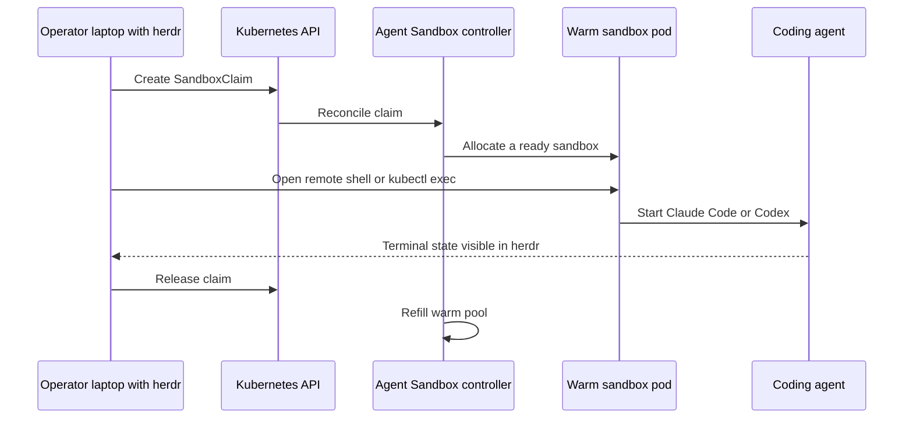

# Homelab domain concepts and invariants

## Product goal versus implemented scope

The master plan (`docs/PROJECT-PLAN.md`) describes a learning-oriented, reproducible Kubernetes homelab that will host normal applications and disposable AI coding environments on the same physical cluster. Planned end-state capabilities include GitOps, ingress and load balancing, persistent storage, encrypted secrets, monitoring, Tailscale access, Agent Sandbox warm pools, herdr, backups, and eventual control-plane HA.

The current repository implements only the base layers needed by the [Provisioning Workflows](../workflows/provisioning.md): Ubuntu installation scaffolding, host convergence, hardening, container runtime and Kubernetes packages, kubeadm bootstrap, Cilium, and worker joins. Engineers should not infer implemented behavior from roadmap diagrams or planned directory trees.

## Everything as code, with staged learning

Two principles explain many design choices:

1. **Reproducibility:** repeated manual configuration across three hosts is rejected in favor of autoinstall, Ansible, and future Argo CD.
2. **Climb the ladder:** build a working single-control-plane cluster before HA, basic Cilium before optional Hubble/L7 features, and simple workload isolation before sophisticated load-aware scheduling.

That learning goal is why the current design uses upstream kubeadm rather than hiding cluster mechanics behind a more packaged distribution. The earlier decision document considered k3s and Talos, but the current master plan decides on Ubuntu plus kubeadm; executable source and recent history support that choice.

## Ownership model

The domain has two intended reconciliation authorities:

- The [Architecture Overview](../architecture/overview.md) assigns operating-system and bootstrap state to Ansible.
- Future Argo CD owns Kubernetes platform and application resources after bootstrap.

This avoids long-term overlap where both Ansible and GitOps mutate the same in-cluster object. Until the `clusters/` tree exists, only the Ansible half is implemented.

## Topology and quorum

Stage A is one control plane and two workers. One control plane accepts a temporary single point of failure in exchange for a simpler learning and bootstrap path. Exactly two control-plane nodes are forbidden because etcd requires a majority; losing either would remove quorum. The future HA shape is three control planes behind kube-vip.

The control-plane taint remains by default, so ordinary workloads should land on workers. Removing it is an explicit capacity tradeoff, not part of provisioning.

## Identity model

There are two administrative identities:

- `admin_user` is the human, break-glass sudo account.
- `ansible_service_user` separates automation key rotation and audit trails, but intentionally has equivalent root capability because Ansible requires privilege.

The automation account is created by code, yet `ansible_user` still points to the human account. Cutover is a manual lifecycle: generate the dedicated key, run host convergence, test direct login and `sudo -n true`, then change connection settings. `preflight` requires both identities and the current connection account to remain in `ssh_allowed_users`, preventing an obvious fleet-wide lockout.

## Network identity is immutable cluster input

Three values form the cluster's network identity:

| Concept | Current value/source | Why it matters |
|---|---|---|
| Node address | `ansible_host` in `ansible/inventory.ini` | SSH, UFW peer trust, kubelet address, endpoint mapping, API advertise address |
| API endpoint | `k8s.lab.example` in `ansible/group_vars/all.yml` | Included in API certificates; named for future HA redirection |
| Pod CIDR | `10.244.0.0/16` | Assigned by kubeadm and consumed by Cilium host-scope IPAM |

Changing these after bootstrap is not a routine variable edit. The API advertise address and endpoint enter certificates, and the Pod CIDR enters cluster/CNI state. The [Operations Runbook](../operations/runbook.md) therefore treats a reset as the default recovery for this pre-workload cluster.

UFW trusts node LAN addresses wholesale for cluster traffic and allows management/ingress ports only from `ssh_allowed_from`. `DEFAULT_FORWARD_POLICY=ACCEPT` is necessary for forwarded pod traffic. Cilium uses VXLAN and standard NetworkPolicy but does not replace kube-proxy.

## Version and supply-chain model

User-facing pins live together in `ansible/group_vars/all.yml`:

- Kubernetes repository minor plus exact package version.
- Exact Ubuntu-suite-specific `containerd.io` version.
- Cilium chart version plus immutable OCI manifest digest.
- SHA-256 pins for Kubernetes and Docker apt signing-key downloads.

Version relationships are part of correctness. The package version must belong to the selected Kubernetes minor. The containerd pin must match the nodes' actual Ubuntu suite. The Cilium digest must be regenerated and verified when its version changes. Helm is controller-side infrastructure and currently fails closed outside `>=4.2.0,<5.0.0` for Kubernetes 1.36.

This model is strong but incomplete: the optional Tailscale path downloads a root-executed installer without a checksum. That pending exception is tracked in `todos/017-pending-p2-tailscale-block-gaps.md` and called out in [Operations Runbook](../operations/runbook.md).

## Host safety model

Security and availability choices are coupled:

- SSH permits keys only, disallows root, and validates config before reload.
- UFW denies incoming traffic by default but explicitly supports node and pod networking.
- Unattended security updates run, but automatic reboot is disabled so Kubernetes nodes can be drained.
- `site.yml` mutates one node at a time and stops globally on failure.
- Kubernetes and containerd packages are held against incidental upgrades.
- High-risk managed files keep backups, though automation has no transaction-wide rollback.

These controls explain why role order and handler timing in the [Architecture Overview](../architecture/overview.md) are domain behavior, not implementation trivia.

## Planned workload model

The future cluster remains one physical cluster because three small nodes cannot efficiently support separate physical environments. Logical isolation is planned through namespaces, resource requests and limits, quotas, taints/tolerations, topology spreading, and NetworkPolicies.

For agent workloads, Kubernetes and herdr solve different problems:

- **Agent Sandbox** is intended to define `SandboxTemplate` environments, keep a `SandboxWarmPool`, and allocate ready pods through `SandboxClaim`.
- **herdr** is a laptop-side terminal dashboard. It does not create or pre-warm pods; it observes and controls agents running in an already available shell, reached by `kubectl exec` or another remote seam.

*This is the planned agent workflow from project documentation; none of these in-cluster resources are implemented in the current source tree.*

SSD capacity is the principal physical constraint for this model: large development images, warm replicas, metrics, and logs multiply storage consumption. Future platform work should keep images lean and retention bounded.

## Current decision caveats

- Planning docs still mention Ubuntu 24.04 in places; current inventory, variables, README, and package pins target Ubuntu 26.04 `resolute`.
- An older decision doc recommends a k3s-to-Talos path; the later master plan and implemented source choose kubeadm on Ubuntu and decide Talos out.
- Tailscale appears in host provisioning before its planned roadmap phase but does not yet provide working remote SSH under current firewall inputs.
- The Cilium implementation is working-tree state rather than a committed, tested release. Consult [Testing and Validation](../testing.md) before relying on it.
