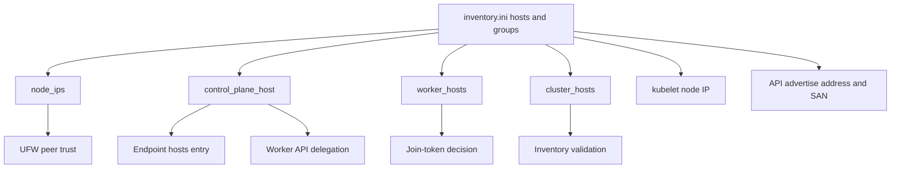

# Configuration and security invariants

## Sources of truth

`ansible/inventory.ini` owns topology and node addresses. `ansible/group_vars/all.yml` owns user-facing site configuration and derives role-facing values from inventory groups. Role defaults own implementation details such as package lists and minimal Cilium values.

This data flow explains why inventory addresses and group membership affect networking, certificates, delegation, and bootstrap behavior.

The [architecture overview](/openwiki/architecture/overview.md) describes the components consuming these values; the [provisioning workflows](/openwiki/workflows/provisioning.md) show when they are applied.

## Load-bearing network values

### Node addresses

Each `ansible_host` must be a literal, stable IPv4 address. The addresses feed:

- SSH connectivity;
- unrestricted UFW peer rules;
- `node_ips`;
- the node-side `/etc/hosts` mapping for the API endpoint;
- kubelet `--node-ip`;
- kubeadm `--apiserver-advertise-address` and certificate SANs.

Set DHCP reservations before bootstrap. A later reassignment can break peer firewall trust, kubelet identity, and API certificates at once.

### Control-plane endpoint

`control_plane_endpoint` must be a DNS name. Nodes receive an `/etc/hosts` entry from the base role, but the laptop does not; use `make hosts`. The fetched kubeconfig retains this DNS name by design. It preserves a future move to kube-vip without reissuing endpoint certificates.

### Pod CIDR and Cilium

`pod_cidr` must not overlap the LAN. kubeadm allocates per-node PodCIDRs and Cilium consumes them using Kubernetes IPAM. The current Cilium profile uses VXLAN and retains kube-proxy. UFW therefore needs forwarding enabled and trusted inter-node traffic, including VXLAN UDP 8472.

## Identity model

Two accounts have distinct operational identities but equivalent effective privilege:

- `admin_user`: human and break-glass login; receives a node-local kubeconfig.
- `ansible_service_user`: key-only automation login with `NOPASSWD:ALL`.

The automation account separates audit trails and key rotation; it is **not** privilege separation. Its authorized key is exclusive, source-CIDR restricted, and forwarding-disabled. The service account must be created and manually verified before changing `ansible_user` from the human account.

Preflight requires both users in `ssh_allowed_users` and the currently connecting user in that list. This protects against applying an `AllowUsers` rule that locks out the active session.

## SSH and host firewall

`ansible.cfg` uses host-key checking with `StrictHostKeyChecking=accept-new`: unknown keys are accepted once and pinned, while changed keys abort. For first-connection authenticity, compare the node's physical-console fingerprint out of band. After reimaging, remove the stale key deliberately with `ssh-keygen -R`.

Hardening writes a validated sshd drop-in that disables root, password, keyboard-interactive, empty-password, X11, and agent-forwarding access. UFW applies:

- default-deny inbound;
- default-allow outbound;
- forwarding policy `ACCEPT` for pod traffic;
- complete trust for inventory node IPs;
- SSH and future ingress from `ssh_allowed_from`.

Peer trust is intentionally broad and depends on address integrity. Tailscale traffic is management-plane traffic, not a second cluster network. The tailnet CIDR is currently commented out, so remote SSH remains blocked even if optional Tailscale installation succeeds.

## Version and supply-chain policy

Versions and their verification material live together in `group_vars/all.yml`:

- exact Kubernetes package version plus repository minor and signing-key digest;
- exact Ubuntu-suite-specific containerd version plus Docker key digest;
- exact Cilium chart version plus OCI manifest digest.

Preflight validates digest shape and version/minor agreement. The control-plane role additionally resolves Cilium metadata through the digest and verifies chart name and version. When bumping any artifact, regenerate and independently verify the matching digest rather than editing the version alone.

Collection dependencies in `ansible/requirements.yml` use bounded major ranges. Git hook revisions are pinned in `.pre-commit-config.yaml`.

The optional Tailscale path is an exception: it downloads and runs an unverified current shell script as root. Treat `todos/017-pending-p2-tailscale-block-gaps.md` as an active security and functionality issue.

## Secret handling

Never commit:

- `ansible/kubeconfig` or any kubeconfig containing cluster-admin credentials;
- real `autoinstall/user-data` with password hash and identity key;
- private SSH keys;
- vault password files;
- `tailscale_auth_key` or agent API keys.

`.gitignore` excludes expected paths, while pre-commit uses gitleaks and private-key detection for unexpected placement. Secret scanning complements but does not replace careful review.

The worker join command is protected with `no_log` because its output is the token. `kubeadm init` instead uses `--skip-token-print`, retaining failure diagnostics. Tailscale authentication also uses `no_log`, but its key still needs a declared encrypted storage path before the feature is production-ready.

## Change checklist

When changing inventory, networking, identity, or pinned versions:

1. Trace every derived consumer in the diagram above.
2. Run the static and secret gates from [testing and validation](/openwiki/testing.md).
3. Confirm no endpoint, advertise address, or pod-CIDR change is being applied to an initialized cluster unintentionally.
4. Preserve both login accounts during automation-user migration.
5. Test UFW and SSH changes in the hardening Molecule scenario and on one physical node before fleet rollout.
6. Follow the deployment and rollback guidance in the [operations runbook](/openwiki/operations/runbook.md).
