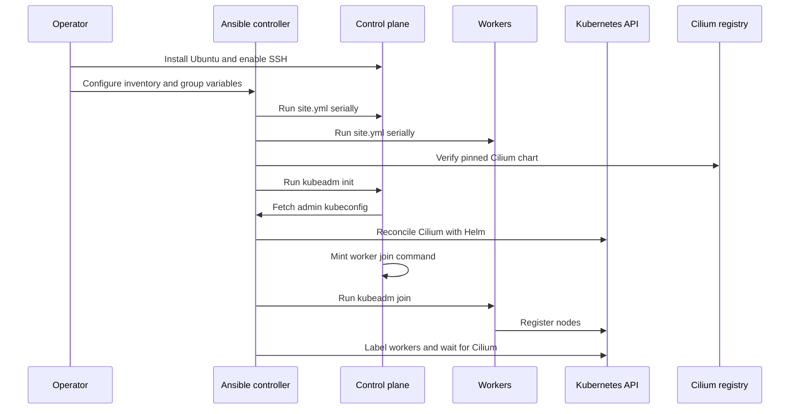
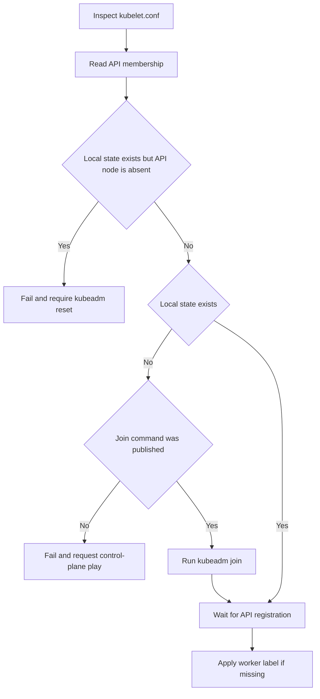

# Provisioning and bootstrap workflows

## End-to-end sequence

The workflow is deliberately staged because node convergence is repeatable, while several kubeadm inputs become difficult to change after initialization.



This sequence shows controller-driven host convergence and cluster bootstrap, including external chart verification and API-based worker validation.

Before executing it, review the load-bearing values in [configuration and security](/openwiki/domain/configuration-and-security.md). Use the [operations runbook](/openwiki/operations/runbook.md) for commands and recovery.

## 1. Install the operating system

`autoinstall/user-data.example` is a template, not a production-ready unattended installer. The intended process is:

1. Install `node-1` interactively.
2. Create EFI, `/boot`, root, and a large separate `/var` logical volume; leave growth space and configure no swap.
3. Harvest `/var/log/installer/autoinstall-user-data` from the successful installation.
4. Replace the example storage block and customize hostname, password hash, public key, and sudo rule per node.
5. Use that known-good configuration for nodes 2 and 3.

The checked-in example uses a whole-disk LVM preset and explicitly does not implement the desired `/var` layout. It also contains literal identity values that must remain synchronized with `admin_user`. The real `autoinstall/user-data` is ignored because it contains sensitive identity material.

## 2. Validate controller and configuration

Run:

```bash
make deps
make check
make test
make ping
```

Preflight executes at the start of both playbooks and fails before touching irreversible bootstrap choices. Among other checks, it requires:

- ansible-core 2.14 or newer;
- all expected identities and network values;
- valid 64-character artifact digests;
- both admin and automation users in `ssh_allowed_users`;
- a DNS name for `control_plane_endpoint`;
- a Kubernetes package version matching the configured minor;
- an explicit IPv4 `ansible_host` for each cluster node;
- exactly one Stage A control plane.

The pod-CIDR collision check only rejects `192.168.*`; it is not general subnet arithmetic. Operators on another LAN must reason about overlap themselves.

## 3. Converge each node

`make nodes` executes `ansible/site.yml`. The play uses `serial: 1` and `any_errors_fatal: true`, so one failed host stops the rollout while the remaining hosts are untouched.

Important effects:

- Every run performs an apt safe upgrade, making it a patch event.
- SSH and sudo files are validated before activation and usually retain backups.
- UFW trusts inventory node addresses and permits forwarding required by Kubernetes.
- Containerd is pinned and configured with `SystemdCgroup = true`.
- Kubernetes tools are installed at exact versions and intended to remain held.
- Kubelet gets `--node-ip={{ ansible_host }}` before joining.

If sudo requires a password, invoke the playbook directly with `--ask-become-pass`. The automation-user rollout is two-stage: first create and verify the service account while connected as the human admin, then switch `ansible_user` and verify `make ping`.

A recent review found that the package hold logic uses a stale pre-unhold snapshot, so already-held packages can finish unheld. Fix and validate that issue before relying on repeated patch runs. It is tracked in the [operations runbook](/openwiki/operations/runbook.md).

## 4. Initialize the control plane and Cilium

The control-plane role first requires Helm 4.2.x and checks for `/etc/kubernetes/admin.conf`.

On a new cluster it verifies the Cilium OCI digest resolves to the configured chart name and version **before** running `kubeadm init`. Initialization supplies:

- the DNS `control_plane_endpoint`;
- `ansible_host` as the API advertise address and certificate SAN;
- the configured `pod_cidr`;
- the inventory hostname as the node name;
- `--skip-token-print` to preserve diagnostics without printing the initial token.

The role installs admin kubeconfig files on `node-1` and at `ansible/kubeconfig` on the controller with restrictive permissions.

Cilium reconciliation then:

1. refuses to proceed if the legacy `calico-node` DaemonSet exists;
2. reads the current Helm release and user-supplied values;
3. compares deployment status, chart version, and exact desired values;
4. verifies the digest again when reconciling an existing cluster;
5. runs `helm upgrade --install` with rollback-on-failure only on drift;
6. removes temporary values and waits for Cilium and `node-1` readiness.

This flow is idempotent by state comparison, not by always invoking Helm. On an empty Calico cluster, reset and rebuild rather than installing two CNIs together.

## 5. Join workers

The control plane queries API membership and only creates a 24-hour join token if inventory workers are missing. The token-backed command is published as an in-memory host fact for the worker play.

For each worker, the role compares local `/etc/kubernetes/kubelet.conf` with actual API membership:



This decision flow prevents leftover kubeadm files from being mistaken for valid cluster membership.

Running worker tags alone cannot mint a token for a new node. Run the control-plane play first or use the full `make cluster` flow.

## 6. Validate the result

After `make cluster`:

```bash
make hosts
make status
```

`make hosts` prints the laptop `/etc/hosts` entry required by the fetched kubeconfig. `make status` verifies name resolution and lists all nodes and pods.

Do not stop at `Ready`. Validate Cilium 3/3 rollout, CoreDNS, DNS resolution from a pod, and cross-node pod traffic as described in [testing and validation](/openwiki/testing.md).
